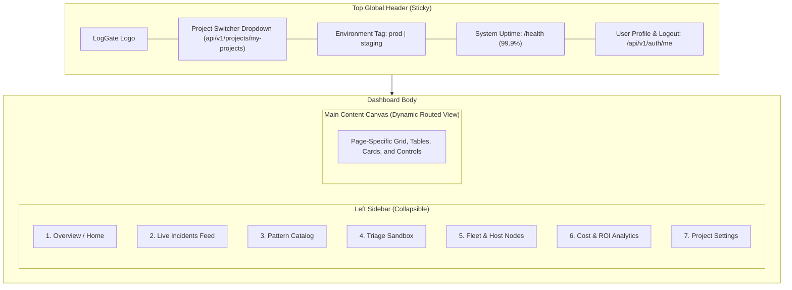
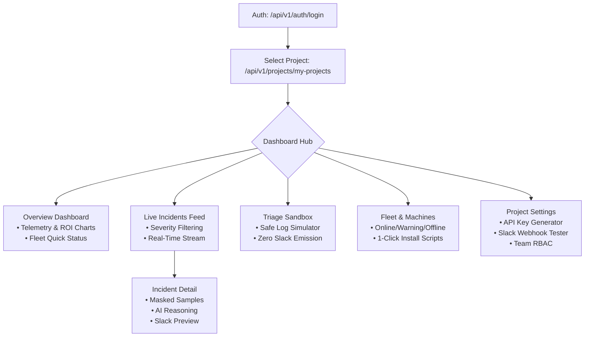

# LogGate Dashboard — UI & UX Architecture Document
*A Supabase-inspired, developer-first interface for real-time log triage, noise reduction, and intelligent alert routing.*

---

## 1. Executive Summary & Design Philosophy

The LogGate frontend is modeled after modern developer tools like **Supabase**, **Vercel**, and **Grafana**:
- **Information-Dense yet Clean**: High signal-to-noise ratio, monospace fonts for technical tokens/hashes, and compact table grids.
- **Supabase-Style Navigation**: Top project-switcher header combined with a persistent, collapsible left sidebar featuring iconic navigation.
- **Real-Time Visual Cues**: Glowing status pills (`Healthy`, `Warning`, `Offline`), animated telemetry charts, and live incident stream badges.
- **Dark-Mode First**: High contrast dark theme (`#0c0d0e` canvas, `#16181a` surface, `#23272b` border) with vibrant functional accents (Emerald Green for health, Amber for warnings, Coral Red for outages, and Supabase Green / Electric Blue for primary CTAs).

---

## 2. Navigation & Information Architecture

### Global Layout Structure


---

## 3. Comprehensive Page-by-Page Specifications

---

### Page 1: Overview Dashboard (`/projects/:projectId`)
*The command center showing instantaneous fleet health, noise reduction ratios, and active outage banners.*

#### UI Layout & Components
1. **System Resilience Banner (Top, Conditional)**:
   - Triggers when upstream models are slow, Slack webhook is failing, or machine drops are detected.
   - Alert styles: Amber warning banner with actionable fix button.
2. **Key Metric Hero Cards (4-column grid)**:
   - **Reduction Ratio**: e.g. `98.4%` (Comparing raw lines to judged incidents).
   - **Cost Avoided This Month**: e.g. `$2,418.50` (Calculated using bytes reduced $\times$ configurable price/GB).
   - **Active Incidents**: Count of unresolved incidents tagged `Critical` or `Warning`.
   - **Fleet Status**: e.g. `12 / 12 Nodes Online` (Pill showing healthy vs warning vs offline).
3. **Telemetry Activity Charts (2-column layout)**:
   - *Left*: Daily Ingested vs Reduced Bytes (Area chart over 14 days).
   - *Right*: Incident Severity Distribution (Stacked bar chart: Critical vs Warning vs Benign).
4. **Recent High-Severity Incidents Table**:
   - Quick preview of the top 5 most recent actionable incidents with 1-click drilldown into the Incident Detail view.

#### Backend API Connections:
- `GET /api/v1/projects/metrics/{project_id}`
- `GET /api/v1/projects/{project_id}/display_machines`
- `GET /api/v1/projects/{project_id}/logs?severity_label=critical&page_size=5`

---

### Page 2: Live Incidents Feed (`/projects/:projectId/incidents`)
*The primary operational screen for on-call SREs and engineers during ongoing issues (URD FR-19).*

#### UI Layout & Components
1. **Filter & Search Toolbar (Supabase Table Style)**:
   - **Search Input**: Live substring filter across error patterns.
   - **Environment Multi-Select**: `production`, `staging`, `canary`.
   - **Service Dropdown**: Filter by service name (`auth-service`, `payment-gateway`, etc.).
   - **Severity Toggles**: Quick filter chips for `[Critical]`, `[Warning]`, `[Benign]`.
   - **Alerted Only Checkbox**: Toggle to view only incidents that dispatched Slack notifications.
2. **Incident Stream Table**:
   - Columns:
     - `Severity`: Pill badge with distinct color:
       - 🔴 **Critical** (Score $\ge 1.8$, Red)
       - 🟡 **Warning** (Score $1.2 - 1.8$, Amber)
       - ⚪ **Benign** (Score $< 1.2$, Muted Gray)
     - `Incident Pattern`: Truncated monospace code snippet showing the masked log pattern.
     - `Service & Env`: Badges (e.g. `payment-gateway` `prod`).
     - `Occurrences`: Raw lines represented (e.g. `14,250 lines`).
     - `Hosts`: Pill tags indicating reporting host count (e.g. `4 hosts`).
     - `Last Seen`: Relative time timestamp (e.g. `2 mins ago`).
     - `Slack Status`: Icon showing green checkmark if delivered, gray if muted.
   - Row click navigates to **Incident Detail Page**.
3. **Pagination Footer**: Page size selector (`30`, `50`, `100`), page number navigator.

#### Backend API Connections:
- `GET /api/v1/projects/{project_id}/logs?page_number=1&page_size=30&service=...&environment=...&severity_label=...&search=...`

---

### Page 3: Incident Detail Page (`/projects/:projectId/incidents/:logId`)
*Deep-dive forensic view for diagnosing a specific grouped error (URD FR-20, FR-11).*

#### UI Layout & Components
1. **Incident Header**:
   - Breadcrumb: `Projects > payment-api > Incidents > #INC-8492`
   - Incident title (Canonical Pattern), Status badge, First seen / Last seen timestamps.
2. **Split Pane Layout (2 Columns: 65% / 35%)**:
   - **Left Column (Forensic Evidence)**:
     - **Canonical Pattern Box**: Full monospace code block with copy button and highlighted dynamic tokens (e.g., `<IP>`, `<UUID>`, `<NUM>`).
     - **Sample Log Lines (Max 3 lines)**: Realistic raw sample lines captured from the host showing actual error context.
     - **Fleet Distribution**: Breakdown of which host machines reported this pattern and their individual occurrence counts.
     - **Time Window**: Window start and window end UTC timestamps.
   - **Right Column (AI Decision & Slack Delivery)**:
     - **AI Decision Card**:
       - Score meter: e.g. `2.45 / 3.00`
       - Actionable Probability: `98.2%`
       - Decision Reasoning: Bulleted summary explaining why this constitutes an actionable bug.
     - **Slack Notification Preview Card**:
       - Visual replica of the exact Slack Block Kit card dispatched to the organization's channel.
       - Delivery status (`Delivered 200 OK` or `Retrying`).

#### Backend API Connections:
- Stored log record retrieved from `GET /api/v1/projects/{project_id}/logs`.

---

### Page 4: Pattern Browser & Reduction Catalog (`/projects/:projectId/patterns`)
*Searchable catalog of all deduplicated patterns across the system lifetime (URD FR-21).*

#### UI Layout & Components
1. **Catalog Summary Stats**:
   - Total Distinct Patterns Discovered.
   - Average Reduction Ratio across fleet.
2. **Searchable Pattern Table**:
   - Columns: Canonical Pattern, Service, Lifetime Raw Lines Represented, Lifetime Bytes Avoided, First Seen, Last Seen, Last AI Severity Decision.
   - Fast instant search filtering by substring or regex.

#### Backend API Connections:
- `GET /api/v1/projects/{project_id}/logs?search=...`

---

### Page 5: Interactive Triage Sandbox (`/projects/:projectId/sandbox`)
*Safe testing ground for pasting sample logs and testing AI severity scoring without emitting Slack alerts (URD FR-25, US-08).*

#### UI Layout & Components
1. **Input Panel (Left Half)**:
   - **Environment Selector**: Radio group (`production` vs `staging` vs `dev`).
   - **Service Name**: Text input (e.g. `auth-api`).
   - **Raw Log Textarea**: Monospace editor where engineers paste multi-line stack traces or sample log entries.
   - **Simulate Button**: Primary CTA with keyboard shortcut (`Cmd + Enter`).
2. **Decision Output Panel (Right Half)**:
   - Empty state illustration before run.
   - Upon execution:
     - **Computed Severity Badge**: `Critical`, `Warning`, or `Benign`.
     - **Numerical Score**: e.g. `2.10 / 3.00`.
     - **Probability Gauge**: Visual circular progress bar of actionable probability.
     - **Slack Routing Simulation Verdict**:
       - Green Callout: *"At current threshold (1.8), an alert WOULD be posted to #alerts-prod."*
       - Gray Callout: *"Below threshold. This incident would be logged silently without paging on-call."*

#### Backend API Connections:
- `POST /api/v1/triage/simulate` (or `/api/v1/triage/push`)

---

### Page 6: Fleet & Host Management (`/projects/:projectId/fleet`)
*Plug-and-play host node monitoring and install instructions (URD HM-01 to HM-07, US-12).*

#### UI Layout & Components
1. **Quick Connect Drawer / Card (Supabase-Style Setup)**:
   - Copyable 1-line installation commands tabbed by OS:
     - **Linux (Systemd)**:
       ```bash
       curl -sSL https://<SERVER>/install.sh | sudo bash -s -- --server "https://<SERVER>" --access-key "lg-live-..." --service "my-api"
       ```
     - **macOS (Homebrew/Daemon)**:
       ```bash
       curl -sSL https://<SERVER>/install.sh | bash -s -- --server "https://<SERVER>" --access-key "lg-live-..." --service "my-api"
       ```
     - **Windows (PowerShell)**:
       ```powershell
       iex ((New-Object System.Net.WebClient).DownloadString('http://<SERVER>/install.ps1')) -Server "http://<SERVER>" -AccessKey "lg-live-..."
       ```
     - **Docker Container**:
       ```bash
       docker run -d -v /var/log/app:/var/log/app -e LOGGATE_SERVER="https://<SERVER>" -e LOGGATE_ACCESS_KEY="lg-live-..." loggate-agent
       ```
2. **Connected Machines Table**:
   - Columns:
     - `Status`:
       - 🟢 **Healthy** (`last_seen_at` < 5m ago)
       - 🟡 **Warning** (5m - 30m ago)
       - 🔴 **Offline** (> 30m ago)
     - `Hostname`: e.g. `prod-api-worker-01`
     - `Service & Env`: e.g. `payment-gateway` (`production`)
     - `Last Seen Heartbeat`: Relative time (e.g. `12 seconds ago`)
     - `Machine ID`: Truncated UUID with copy button.

#### Backend API Connections:
- `GET /api/v1/projects/{project_id}/display_machines`
- `GET /api/v1/install.sh` & `GET /api/v1/agent/releases`

---

### Page 7: Project Settings (`/projects/:projectId/settings`)
*Organized into clean Supabase-style sub-tabs on the left.*

#### Sub-Tab A: General Settings
- Project Name modification.
- Project ID display (UUID).
- **Danger Zone**: Delete Project (owner only) with double-confirmation modal.
  - *Backend*: `DELETE /api/v1/projects/{project_id}/delete`

#### Sub-Tab B: API Keys / Ingestion Tokens
- Table of active keys:
  - Key Prefix (e.g. `lg-live-9f82...`).
  - Created Date, Last Used Timestamp, Active status toggle.
  - Revoke key button (`POST /api/v1/tokens/revoke-token`).
- **Create New Key Modal**: Generates 32-byte secure key, displays raw token **once** with copy button (`POST /api/v1/tokens/create-token`).

#### Sub-Tab C: Slack Alerting Integration
- Webhook URL input box with password mask toggle.
- **Save Configuration Button**: `POST /api/v1/projects/set-slack-channel`.
- **Test Webhook Button**: `POST /api/v1/projects/{project_id}/test-slack`
  - Fires an immediate Block Kit test message to verify Slack channel permissions and displays live success/error notification.

#### Sub-Tab D: Team & Membership
- Table of team members with assigned roles (`owner`, `member`).
- Add Member form by User ID / Email (`POST /api/v1/projects/add-member`).
- Remove Member button (`POST /api/v1/projects/remove-member`).

---

## 4. Supabase-Inspired UI Theme & Design Tokens

### Color Palette (Tailwind / CSS Variables)
```css
:root {
  /* Canvas & Backgrounds */
  --bg-canvas: #0c0d0e;        /* Deepest background */
  --bg-surface: #141618;       /* Card & sidebar background */
  --bg-surface-hover: #1c1f23; /* Interactive table row hover */
  --border-subtle: #23272b;    /* Borders and separators */
  --border-focus: #3b82f6;     /* Input focus ring */

  /* Primary Brand (Electric Green / Supabase Glow) */
  --brand-primary: #10b981;    /* Primary CTA / Success */
  --brand-accent: #3b82f6;     /* Link & telemetry highlight */

  /* Functional Status Accents */
  --status-critical: #ef4444;  /* 500s / Outages / Outage badge */
  --status-warning: #f59e0b;   /* Degraded / Warnings */
  --status-healthy: #10b981;   /* Online nodes / 200 OK */
  --status-muted: #6b7280;     /* Benign noise logs */

  /* Monospace Typography */
  --font-mono: 'JetBrains Mono', 'Fira Code', Menlo, monospace;
  --font-sans: 'Inter', -apple-system, BlinkMacSystemFont, sans-serif;
}
```

---

## 5. Summary Flowchart for Developers


